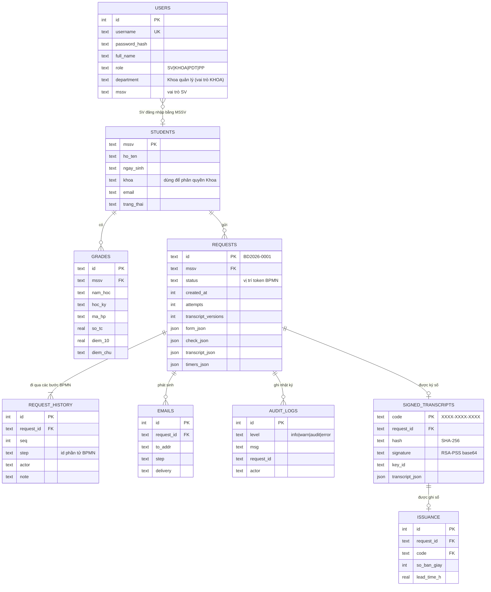

# Thiết kế phần mềm (tài liệu kỹ thuật kèm mã nguồn)

Tài liệu này mô tả thiết kế thực tế của mã nguồn trong thư mục này, dùng làm tư liệu cho mục **3.3 Thiết kế phần mềm** và **4.1 Ứng dụng web** của báo cáo.

## 1. Mô hình dữ liệu (SQLite, `bangdiem/schema.sql`)

Bảng `settings` (khóa–giá trị) lưu cấu hình ngưỡng, bộ đếm mã yêu cầu, độ lệch đồng hồ mô phỏng và cờ giả lập sự cố.

Ghi chú thiết kế:

- `requests.status` là **vị trí token** trên BPMN (vd. `CHO_KHOA` = đang ở user task `t_khoa`). Danh sách đầy đủ ở `bangdiem/bpmn.py`.
- `request_history.step` lưu đúng **id phần tử** trong tệp `.bpmn`, nên giao diện tô sáng được đường đi trên sơ đồ.
- Các phần có cấu trúc lồng nhau và thay đổi theo phiên bản (form, kết quả đối chiếu, bảng điểm) lưu dạng JSON để không phải đổi lược đồ khi thêm trường.
- `grades.mssv` và `users.mssv` là liên kết logic, không ràng buộc khóa ngoại cứng, để Phòng Đào tạo nhập điểm trước khi có hồ sơ sinh viên mà không bị chặn.

## 2. Màn hình và vai trò

| Màn hình | Vai trò truy cập | Phần tử BPMN |
|---|---|---|
| Đăng nhập (SSO mô phỏng) | Tất cả | `s_task` (bước đăng nhập) |
| Tạo yêu cầu bảng điểm | SV | `s_task` |
| Yêu cầu của tôi, hộp thư, bổ sung, hủy | SV | `s_bs_task`, `EventSub_SVChuDongHuy` |
| Rà soát & hiệu chỉnh điểm | KHOA (chỉ SV thuộc Khoa mình) | `t_khoa`, `g_kh` |
| Hàng đợi kiểm tra / chỉnh sửa / in / giao, Sổ cấp phát | PDT | `g_dat`, `t_chinh`, `t_in`, `Activity_15aejsy`, `t_nhatky` |
| Xem xét & ký duyệt, đóng dấu | PP | `t_pd`, `g_pd`, `Activity_0xvx345` |
| Quy trình BPMN (sơ đồ + bảng ánh xạ) | Tất cả đã đăng nhập | toàn bộ |
| Hệ thống & dữ liệu (nhập CSV, cấu hình, đồng hồ, sự cố, nhật ký, kiểm thử) | PDT | timer, `Boundary_LoiTruyXuat` |
| Tra cứu mã xác thực | Công khai, không cần đăng nhập | kiểm chứng `t_dongdau` |

## 3. Ánh xạ BPMN → tính năng

| Phần tử BPMN | Loại | Hiện thực | Quyền |
|---|---|---|---|
| `s_task` Đăng nhập SSO & điền yêu cầu | User task | Màn hình Tạo yêu cầu → `POST /api/requests` | SV |
| `ca_xt` Xác thực & kiểm tra thông tin SV | Service task | `engine.validate_form` (luật X1–X8) | Hệ thống |
| `g_hl` Thông tin hợp lệ? | XOR | Hợp lệ khi đạt cả 8 luật | — |
| `Activity_0ze94gf` Yêu cầu SV bổ sung | Send task | Email tự động (`mailer.py`) | Hệ thống |
| `s_bs_task` Bổ sung thông tin | User task | `POST /api/requests/{id}/supplement` | SV |
| `e_t3` Quá 3 ngày | Timer biên ngắt | `engine.tick` → `t_huy`, `t_guihuy` | Hệ thống |
| `t_truyxuat` Truy xuất điểm theo học kỳ | Service task (đa thể hiện) | `engine.retrieve_grades` | Hệ thống |
| `Boundary_LoiTruyXuat` Lỗi truy xuất | Error biên | `engine.retrieval_failed` → ghi log, email, `End_LoiHeThong` | Hệ thống |
| `t_doichieu` Đối chiếu & kiểm tra điểm | Business rule task | `engine.check_grades` (D0–D7, A1, độ tin cậy) | Hệ thống |
| `g_diem` Điểm đầy đủ, chính xác? | XOR | 0 lỗi **và** độ tin cậy ≥ 0,90 | — |
| `t_khoa` Rà soát & hiệu chỉnh điểm | User task | `POST /api/requests/{id}/grades/{gid}`, `/acknowledge` | KHOA |
| `g_kh` Khoa hiệu chỉnh được? | XOR | `POST /api/requests/{id}/khoa-decision` (`canFix`) | KHOA |
| `b_khoa` Sau 2 ngày | Timer biên không ngắt | Email nhắc Khoa, 1 lần | Hệ thống |
| `t_tao` Tạo bảng điểm điện tử | Service task | `engine.create_transcript` (GPA hệ 4/10, 5 kiểm tra tự động) | Hệ thống |
| `g_dat` Bảng điểm đạt yêu cầu? | XOR | `POST /api/requests/{id}/qc` (`ok`, góp ý bắt buộc khi chưa đạt) | PDT |
| `t_chinh` Chỉnh sửa theo góp ý | User task | `POST /api/requests/{id}/edit` | PDT |
| `t_pd` Xem xét bảng điểm | User task | Màn hình ký duyệt | PP |
| `g_pd` Phó phòng quyết định? | XOR 3 nhánh | `POST /api/requests/{id}/pp-decision` (`approve` / `revise` / `reject`) | PP |
| `b_pp` Sau 1 ngày | Timer biên không ngắt | Email nhắc Phó phòng, 1 lần | Hệ thống |
| `t_dongdau` Ký số & lưu trữ | Service task | `signing.Signer.sign` (RSA-PSS SHA-256) + bảng `signed_transcripts` | Hệ thống |
| `Gateway_0m52u6m` / `Gateway_198pqrp` | Cổng bao hàm | Email luôn gửi; bản giấy nếu SV chọn; ghi sổ khi đủ nhánh | — |
| `t_in`, `Activity_0xvx345`, `Activity_15aejsy` | User/manual task | `/print` (PDT), `/stamp` (PP), `/deliver` (PDT) | PDT, PP |
| `t_nhatky` Ghi nhật ký cấp phát | Service task | Bảng `issuance` | Hệ thống |
| `EventSub_SVChuDongHuy` | Event sub-process ngắt | `POST /api/requests/{id}/cancel` | SV |

**Lane → phân quyền**: decorator `auth("SV" | "KHOA" | "PDT" | "PP")` trong `app.py` chặn mọi API không thuộc làn của người dùng (HTTP 403). Ngoài vai trò còn kiểm tra **phạm vi**: SV chỉ thấy yêu cầu của mình, Khoa chỉ thấy SV thuộc Khoa mình. Mỗi thao tác còn kiểm tra **đúng bước** (yêu cầu phải đang ở trạng thái tương ứng, nếu không trả về HTTP 409).

## 4. Ngăn xếp công nghệ

| Thành phần | Lựa chọn | Lý do |
|---|---|---|
| Ngôn ngữ backend | Python 3.10+ | Nhóm đã học; cú pháp gọn để viết luật nghiệp vụ |
| Web framework | Flask 3 | Nhẹ, ít cấu hình, đủ cho REST API và phiên đăng nhập |
| CSDL | SQLite (thư viện chuẩn) | Không cần cài máy chủ CSDL, một tệp duy nhất, có giao dịch ACID |
| Ký số | `cryptography` (RSA-PSS 2048, SHA-256) | Thư viện mật mã chuẩn của Python, được bảo trì tích cực |
| Băm mật khẩu | `werkzeug.security` (scrypt/PBKDF2) | Đi kèm Flask, không lưu mật khẩu gốc |
| Email | `smtplib` (thư viện chuẩn) + hộp thư lưu CSDL | Gửi được qua Gmail/Outlook; vẫn demo được khi không có mạng |
| Frontend | HTML + CSS + JavaScript thuần | Không cần build; chạy ngay bằng `python app.py` |
| Kiểm thử | `unittest` (thư viện chuẩn) | Không cần cài thêm |

## 5. Quyết định kiến trúc

- **Dữ liệu lưu ở đâu**: tệp SQLite `data/bangdiem.db` trên máy chủ. Mỗi lời gọi API là một giao dịch: nạp → xử lý → ghi, lỗi giữa chừng thì rollback. Khóa toàn cục tuần tự hóa các lần ghi.
- **Phân quyền thế nào**: 4 vai trò tương ứng 4 làn BPMN; kiểm tra vai trò + phạm vi + đúng bước ở máy chủ (giao diện chỉ ẩn nút, không phải hàng rào bảo mật). Cookie phiên HttpOnly, SameSite=Lax; mọi thao tác ghi cần mã CSRF; khóa đăng nhập 5 phút sau 5 lần sai; MSSV của yêu cầu lấy từ phiên đăng nhập, không tin dữ liệu gửi lên.
- **Ứng dụng chạy ở đâu**: một tiến trình Flask phục vụ cả API và giao diện tĩnh. Demo trên máy cá nhân (`python app.py`); triển khai thật đặt sau HTTPS (Nginx/Caddy, hoặc Render/Railway/PythonAnywhere) và bật `COOKIE_SECURE=1`.
- **Khóa bí mật cất giữ ra sao**: khóa ký số RSA nằm ở `keys/signing_key.pem`, mã hóa bằng passphrase lấy từ biến môi trường `SIGN_KEY_PASSPHRASE`, quyền tệp 600. Thư mục `keys/` và tệp `.env` nằm trong `.gitignore`, không bao giờ lên Git. Chỉ khóa công khai được công bố (`GET /api/public-key`) để bên ngoài tự kiểm chứng. Khi triển khai thật nên chuyển khóa vào HSM hoặc dịch vụ quản lý khóa (Azure Key Vault, AWS KMS) và dùng chứng thư số của nhà cung cấp được cấp phép.
